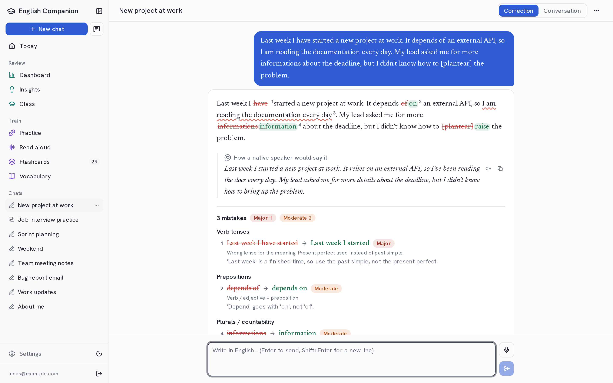
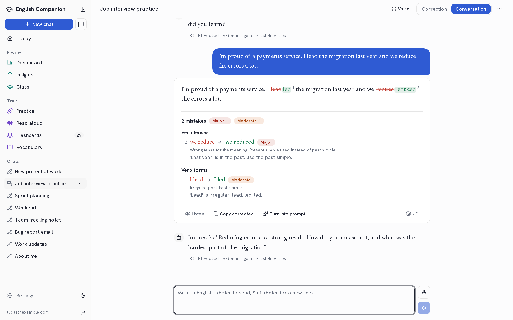
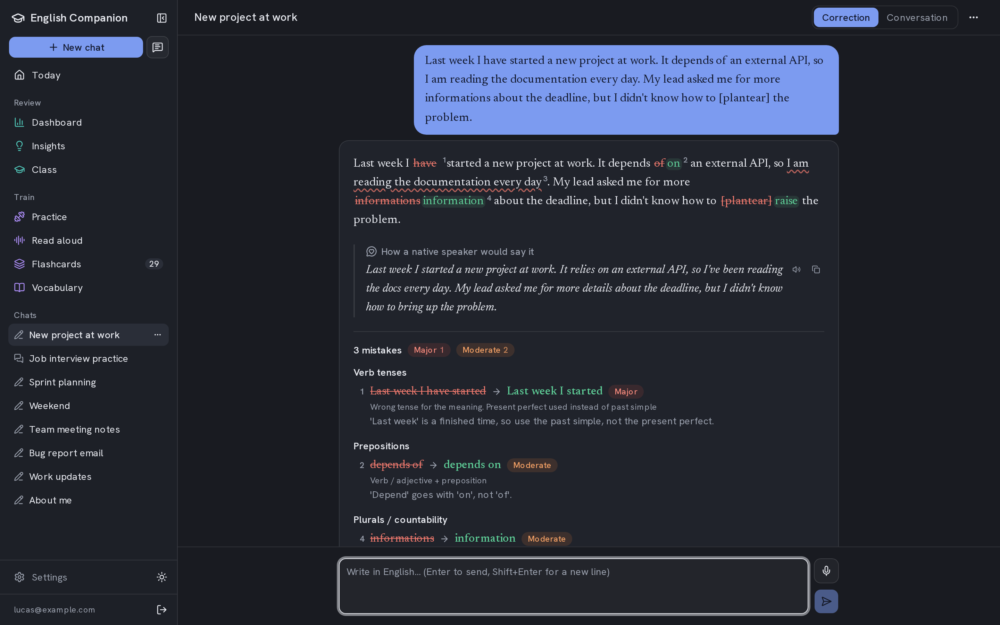
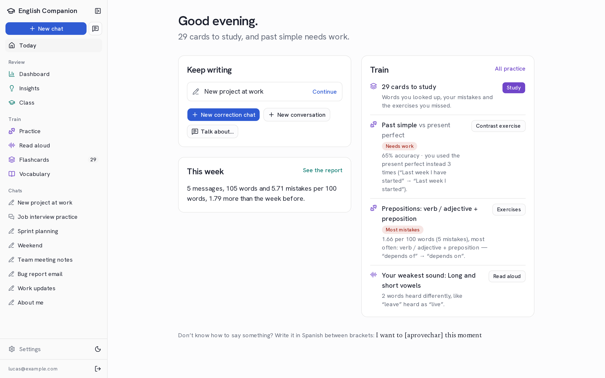
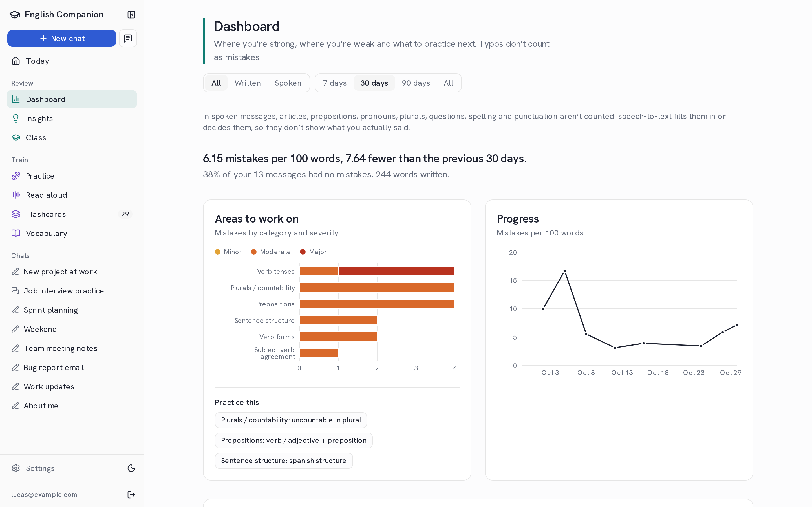
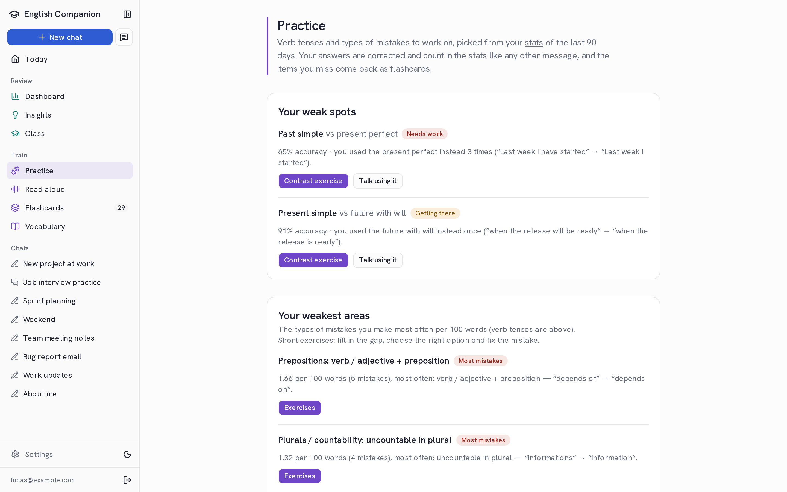
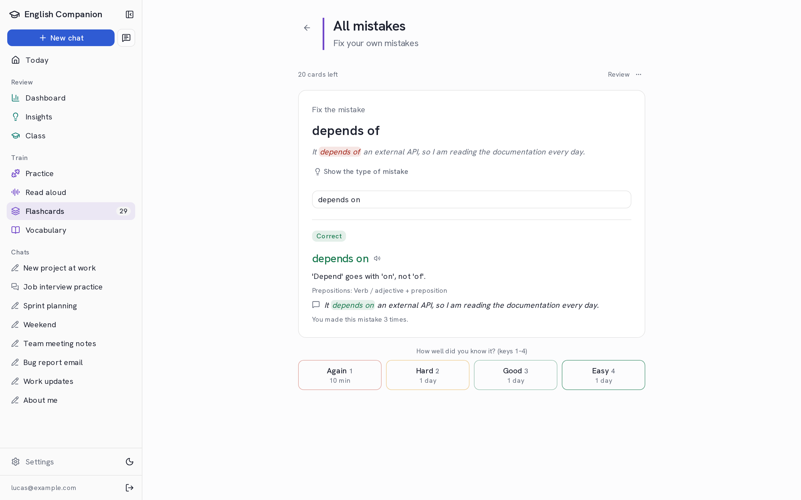
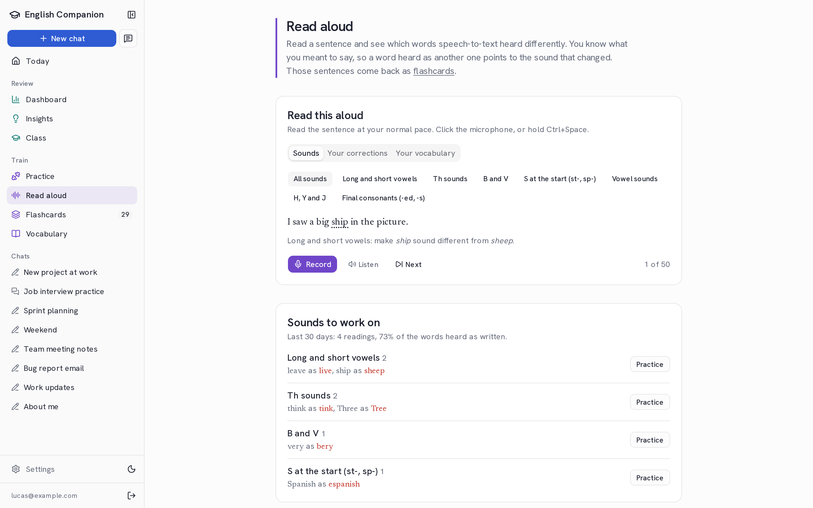
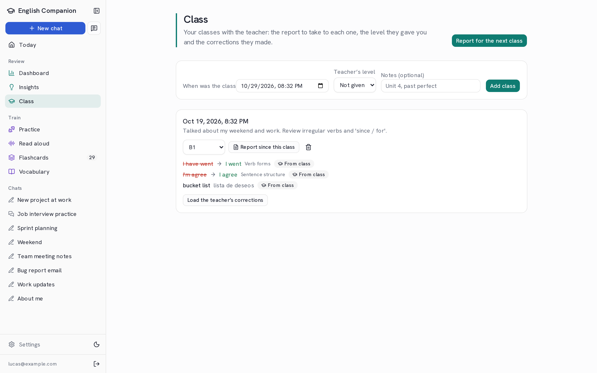
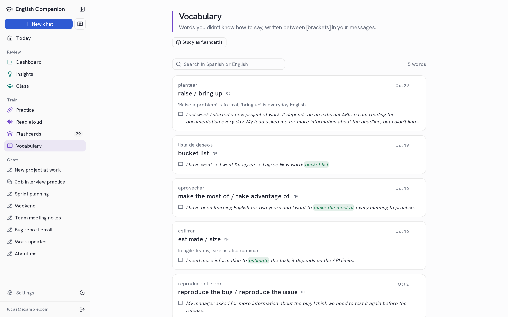

# English Companion

[Español](README.es.md)

An AI English tutor that runs on your machine. Write (or speak) in English and get your message back corrected: every mistake marked, explained and classified. The app keeps your mistakes, so it can show where you're strong, where you're weak, and turn your own errors into practice and flashcards.

It's built for Spanish speakers (explanations in Spanish or English) and it's free to run: corrections use the free tiers of [Gemini](https://aistudio.google.com/apikey) and [Groq](https://console.groq.com/keys), and your data stays in a local SQLite file.



> **Status:** beta (`v0.2.0-beta.1`), used daily by its author. Not deployed yet: you run it locally. The screenshots use invented demo data.

## Features

**Write and get corrected**

- **Correction chats** fix your text; **conversation chats** also answer, so you keep talking (with an optional voice mode). **Talk about…** starts a role-play on a topic, optionally pushing a verb tense, with feedback at the end.
- Each mistake has a category from a fixed list (verb tenses, prepositions, false friends…), a severity and an explanation. A background classifier adds the fine type (_Prepositions › Verb + preposition_) and, for verbs, which tense you needed and which one you used. Wrong type? Fix it by hand.
- **Typos** and **suggestions** (contractions, optional commas) are shown apart and don't count as mistakes. A **native version** shows how it would sound more natural.
- **Spanish escape:** write what you don't know in brackets (`I want to [aprovechar] this`) and get English options, saved to your **Vocabulary**.
- **Dictation** with Whisper (Groq): your speech is transcribed as you said it, mistakes included. Spoken messages are tracked separately and don't count what speech-to-text decides (spelling, punctuation).
- Discard a wrong correction, retry a message, turn a message into a clean AI prompt, listen to it with an in-browser voice ([Kokoro](https://github.com/hexgrad/kokoro)).

| Conversation                                                   | Dark mode                                                           |
| -------------------------------------------------------------- | ------------------------------------------------------------------- |
|  |  |

**See your progress**

- **Today:** what to do next (cards due, the tense that needs work, your weakest sound).
- **Dashboard:** mistakes per 100 words over time, areas to work on, verb tense accuracy and confusions, most frequent mistakes, written vs spoken, pronunciation and flashcard stats.
- **Insights:** a weekly report, a study plan and an estimate of your CEFR level.

| Today                                     | Dashboard                                    |
| ----------------------------------------- | -------------------------------------------- |
|  |  |

**Practice**

- **Practice** picks your weak tenses and mistake types and builds exercises from your own mistakes (fill the gap, choose, fix the error), plus conversations that force a tense.
- **Flashcards** with spaced repetition: words you looked up, your real mistakes, missed exercises and sentences that were hard to say.
- **Read aloud:** read a sentence and see which words speech-to-text heard differently, grouped by the sound that changed (th, b/v, long and short vowels…). A beta sound check runs a phoneme model on the server.

| Practice                                   | Flashcards                                     | Read aloud                                     |
| ------------------------------------------ | ---------------------------------------------- | ---------------------------------------------- |
|  |  |  |

**Classes with a teacher**

- Log your classes, take a report of your mistakes since the last one, get questions to ask, and load the teacher's corrections (structured with AI) so they count in your stats and flashcards.

| Class                                     | Vocabulary                                     |
| ----------------------------------------- | ---------------------------------------------- |
|  |  |

**Accounts and data**

- Login is always on, also locally (email and password). Each account has its own data and its own API keys, stored encrypted.
- Export your data to a JSON file and import it on another machine (no keys or login data in the file).

## Quick start

You need **Node.js 22+**, **pnpm** and at least one free API key ([Gemini](https://aistudio.google.com/apikey) or [Groq](https://console.groq.com/keys); both is better, one covers the other when a quota runs out).

```bash
git clone https://github.com/GabrielMensi/english-companion.git
cd english-companion
pnpm install
pnpm dev
```

1. Open **https://localhost:3737**. The dev server uses HTTPS with a local certificate (the first run may ask to install the [mkcert](https://github.com/FiloSottile/mkcert) CA; see [Troubleshooting](#troubleshooting)).
2. Go to `/signup` and create your account (password of 10+ characters). The first account needs nothing else; after it, signup closes.
3. In **Settings**, paste your API keys and press **Test**. Order the **model chain**: the first model corrects each message and the next ones take over if it fails.
4. Start a chat and write something in English.

The database (`data/companion.db`) is created and migrated on startup. Two secrets are generated next to it the first time: `data/encryption.key` (encrypts your saved API keys) and `data/auth.secret` (signs session cookies). Back up `data/encryption.key` together with the database: without it, saved keys can't be decrypted and you paste them again.

No environment variables are needed locally. Optionally, copy `.env.example` to `.env.local` to set the keys there (used when nothing is saved in the app) or to change other options; each one is explained in the file.

### Recommended models

**Gemini Flash-Lite as the main model and `qwen/qwen3.8-27b` on Groq as the fallback.** From `pnpm eval:models` (September 2026, 16 sentences with typical mistakes of Spanish speakers):

| Model                        | Score   | Avg. time | Notes                                                                     |
| ---------------------------- | ------- | --------- | ------------------------------------------------------------------------- |
| `gemini-flash-lite-latest`   | 96 %    | 2 s       | ~500 requests/day free. The most accurate.                                |
| `qwen/qwen3.8-27b` (Groq)    | 93 %    | ~2 s      | ~110 corrections/day free (200K tokens/day, 8K tokens/minute).            |
| `openai/gpt-oss-120b` (Groq) | 81 %    | ~13 s     | ~1,100 reasoning tokens per correction (~60/day); sometimes invalid JSON. |
| Gemma 4 26B / 31B (Gemini)   | 44–63 % | 7–44 s    | Slow, with timeouts on the free tier.                                     |

The same numbers show in Settings (`MODEL_INFO` in `src/lib/ai/provider-info.ts`). `gemini-flash-latest` is more capable but only gives ~20 requests/day for free.

> On Gemini's free plan, Google may use your data to improve its products. Groq doesn't train on your data but has daily limits.

## More accounts

Signup is closed after the first account. To add people, list their emails in `.env.local` and restart:

```bash
SIGNUP_ALLOWED_EMAILS=ana@example.com,bruno@example.com
```

New accounts start empty and see only their own data. By default an account without its own key uses the keys in `.env.local` (`SHARED_KEYS=true`); with `SHARED_KEYS=false` everyone brings their own. Details in [docs/platform/AUTH_MULTIUSER.md](docs/platform/AUTH_MULTIUSER.md).

## Scripts

| Command                                      | What it does                                                                                     |
| -------------------------------------------- | ------------------------------------------------------------------------------------------------ |
| `pnpm dev`                                   | Development server on https://localhost:3737                                                     |
| `pnpm build` / `pnpm start`                  | Production build and server (http://127.0.0.1:3737)                                              |
| `pnpm test`                                  | Unit tests (Vitest)                                                                              |
| `pnpm test:e2e`                              | End-to-end tests (Playwright) with a throwaway database and a fake AI                            |
| `pnpm typecheck` · `pnpm lint` · `pnpm knip` | Types, lint and unused code. `pnpm format` formats with Prettier                                 |
| `pnpm screenshots`                           | Regenerates the README screenshots from demo data (`scripts/screenshots/`)                       |
| `pnpm db:generate`                           | Creates a migration after changing `src/db/schema.ts`                                            |
| `pnpm db:migrate` · `pnpm db:backup`         | Migrates with a backup first · consistent copy of the database in `data/backups/`                |
| `pnpm auth:reset-password <email>`           | Sets a new password (there's no reset by email) and closes that account's sessions               |
| `pnpm auth:claim-data <email>`               | Gives an account the data saved before accounts existed (backup first, idempotent)               |
| `pnpm keys:reencrypt`                        | Re-encrypts the saved API keys after rotating `APP_ENCRYPTION_KEY`                               |
| `pnpm eval:models <provider>:<model> …`      | Compares models on sentences with known mistakes (`eval:classify`, `eval:asr`, `eval:level` too) |

## Troubleshooting

- **The browser says the certificate isn't trusted.** `pnpm dev` serves HTTPS with a certificate from mkcert (in `certificates/`); HTTPS is needed for the microphone and the floating window. If the browser runs on another OS than the server (Windows browser, WSL server), trust the mkcert CA there once. On Windows: copy `~/.local/share/mkcert/rootCA.pem` from WSL to Windows, run `certutil -user -addstore Root <path>\rootCA.pem` and restart Chrome. Only the public certificate is imported.
- **Forgot the password:** `pnpm auth:reset-password <email>`.
- **Saved API keys show as missing** after copying the database to another folder or machine: copy `data/encryption.key` too, or paste the keys again.
- **The app doesn't start and names a variable:** an invalid value in `.env.local`; the message says which one. Don't set `ALLOWED_HOSTS` locally: it turns on deploy mode, which requires more variables.
- **Port 3737 is taken:** change it in the `dev` and `start` scripts of `package.json`.
- **Several copies on one machine** (for example git worktrees on other ports) each have their own database and their own session cookie, so signing in on one doesn't sign you out of another.

## How it works

Next.js (App Router) · TypeScript · Tailwind and shadcn/ui · SQLite with Drizzle ORM · Vercel AI SDK (Gemini, Groq) · Better Auth · Recharts · Kokoro and transformers.js for voice.

- AI calls go through `src/lib/ai/providers.ts`, with automatic fallback along your model chain. The correction streams to the chat and is saved only once it's complete and validated.
- The error taxonomy (`src/lib/taxonomy.ts`, `src/lib/subtypes.ts`) is fixed so stats group consistently: the model can't invent categories.
- Verb tenses in your text are counted without AI ([compromise](https://github.com/spencermountain/compromise)), and pronunciation is scored by comparing what you read with what speech-to-text heard.
- Pure logic (stats, spaced repetition, normalization) lives in files without server code and has unit tests.

```
src/app/         pages and API routes
src/components/  UI (chat, dashboard, practice, flashcards, settings…)
src/db/          Drizzle schema, migrations on startup, per-user query helpers
src/lib/         AI pipeline, stats, practice, flashcards, voice, auth
drizzle/         SQL migrations
e2e/             Playwright tests
docs/            design docs by area (in Spanish), roadmap
```

Design docs, research and decisions are in [docs/](docs/README.md) (in Spanish); what's done and what's next is in [docs/ROADMAP.md](docs/ROADMAP.md). Work is tracked on the [project board](https://github.com/users/GabrielMensi/projects/1).

## Deploying

The app is ready for a small VPS with Docker Compose and Caddy (Dockerfile, migrations with a backup, deploy script), but it isn't published yet. See [docs/platform/DEPLOY.md](docs/platform/DEPLOY.md) and [docs/platform/RELEASES.md](docs/platform/RELEASES.md).
